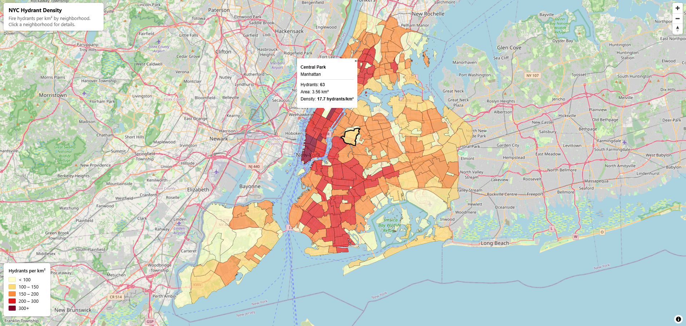

# NYC Hydrant Density Map

An interactive webmap based on my [nyc-spatial-analysis](https://github.com/nwillemsen99/nyc-spatial-analysis) project, completed as part of the GIS Accelerator course.

[Open interactive map](https://nwillemsen99.github.io/nyc-hydrant-map/)

[Open Streamlit dashboard](https://nyc-hydrant-density.streamlit.app/)

Run locally (requires Node.js/npm): ``npx --yes http-server . -p 8080 --cors -c-1``



## Data

The dataset covers all 262 NYC neighborhood tabulation areas from my `nyc-spatial-analysis` project. I exported `hydrant_density.parquet` to GeoJSON and converted it to `neighborhood_density.pmtiles` using Tippecanoe. The vector layer is named `neighborhood_density`. The density field was renamed from `density_per_km2` to `hydrants_per_km2` to match the webmap.

| Field | Description |
|---|---|
| `nta2020` | Neighborhood identifier |
| `ntaname` | Neighborhood name |
| `boroname` | Borough name |
| `hydrant_count` | Number of hydrants in the neighborhood |
| `area_km2` | Neighborhood area in square kilometers |
| `hydrants_per_km2` | Hydrant density per square kilometer |

## Workflow

- If not yet installed, get Python, Bash and Tippecanoe
- Export the neighborhood density GeoParquet to GeoJSON using GeoPandas.
- Convert the GeoJSON into `neighborhood_density.pmtiles` using Tippecanoe.
- Build the interactive map in `index.html` using MapLibre GL JS and the PMTiles plugin.
- Publish `index.html` and the `neighborhood_density.pmtiles` archive through GitHub Pages.

## Technology choices 

| Tool | Purpose |
|---|---|
| MapLibre |displays and styles the interactive map|
| Tippecanoe |converts GeoJSON to vector tiles|
| PMTiles |stores tiles in file which browser can query|
| GitHub Pages |simple webmap hosting without maintaining server|

Selection of tools is based on recommendations in GIS Accelerator course. 

## How to rebuild the tiles

- The `nyc-spatial-analysis` and `nyc-hydrant-map` folders must sit beside each other.
- Input: `../nyc-spatial-analysis/data/processed/hydrant_density.parquet`.
- Run these commands from the `nyc-hydrant-map` folder:
 
 ```bash
python -m pip install -r requirements.txt
bash convert.sh
```

## Results / Visualizations

The map displays NYC neighborhoods colored by hydrant density. Hovering highlights a neighborhood; clicking opens a popup with its hydrant count, area, and density.

## Project files

| File | Purpose |
|---|---|
| `neighborhood_density.geojson` | Export of my analysis results used to generate the PMTiles archive |
| `index.html` | Defines the page, map styling, legend, popups, and hover interactions |
| `neighborhood_density.pmtiles` | Stores the tiled neighborhood geometries and their attributes |
| `convert.sh` | Converts nyc-spatial-analysis parquet output to GeoJSON and then to PMTiles using Tippecanoe |
| `requirements.txt` | Lists required Python packages to run `convert.sh`  |

## Limitations

- The analysis represents hydrant locations in the source dataset and does not assess their condition or operational status.
- NTAs are statistical geographies. Some represent parks, airports, cemeteries, and other non-residential areas rather than conventional neighborhoods.
- Results depend on the versions of the datasets used when the analysis was performed.

## What I learned

I built my first webmap by converting a Parquet output from `nyc-spatial-analysis` into GeoJSON and then into PMTiles using Tippecanoe. Working with the provided `index.html` introduced me to how HTML structures the page and JavaScript configures the map, including styling based on feature attributes.

During local testing, the basemap appeared but the neighborhood layer did not load. With AI assistance, I identified that the Python HTTP server I used lacked the HTTP range support needed to read the PMTiles archive. Switching to `npx --yes http-server . -p 8080 --cors -c-1` resolved the issue.
